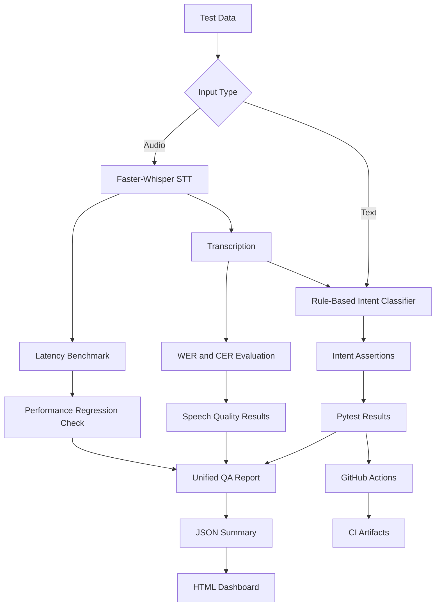

# System Architecture

## 1. Overview

Siri Voice QA Automation is an independent Python-based
QA portfolio project demonstrating multilingual voice
assistant testing, speech recognition evaluation,
performance regression analysis, and automated reporting.

The project does not connect to or test Apple's Siri services.

## 2. High-Level Architecture

The diagram represents the logical relationship between
components. Local speech evaluation and GitHub Actions
run as separate workflows.

## 3. Core Components

### Intent Classification

The rule-based classifier processes Korean, English,
and Japanese text inputs.

Supported intent categories:

- WEATHER
- TIMER
- ALARM
- UNKNOWN
- MULTIPLE_INTENTS

The classifier is a lightweight test target,
not a production NLU or machine-learning model.

### Speech Recognition

The speech recognition component uses Faster-Whisper
with the multilingual Whisper Tiny model.

The local configuration includes:

- CPU inference
- INT8 computation
- Beam size of 5
- Korean, English, and Japanese recordings

Audio fixtures are kept locally and excluded
from version control.

### Speech Quality Evaluation

The speech evaluator compares expected and actual
transcriptions using:

- Word Error Rate (WER)
- Character Error Rate (CER)

The recognized transcription is also passed to
the intent classifier to evaluate downstream behavior.

### Performance Benchmarking

The benchmark runner performs:

- One warm-up inference
- Ten measured inference runs per sample
- Average, minimum, maximum, and P95 latency
- Latency standard deviation
- Real-Time Factor (RTF)
- Speech and intent evaluation

Results are exported as CSV.

### Performance Regression

The regression checker compares current average and
P95 latency against stored baseline values.

The configured regression threshold is 20%.

Invalid benchmark data, missing records,
and inconsistent locale information are validated
before regression evaluation.

## 4. Automated Test Execution

Pytest provides functional and negative test coverage
for intent classification, evaluation utilities,
benchmark data validation, and dashboard generation.

The standard CI suite currently executes 51 tests.

Four additional tests are deselected by default
because they require local speech recordings or
performance benchmark data.

## 5. Reporting Architecture

The reporting pipeline produces:

| Output | Purpose |
|---|---|
| JUnit XML | Machine-readable Pytest results |
| pytest-html | Detailed test execution report |
| Benchmark CSV | Local STT performance measurements |
| Regression CSV | Local baseline comparison results |
| QA Summary JSON | Unified result representation |
| HTML Dashboard | Human-readable QA overview |

The report generator distinguishes between
PASS, FAIL, and NOT_RUN where applicable.

## 6. CI/CD Architecture

GitHub Actions runs on pushes and pull requests
targeting the main branch.

The workflow:

1. Checks out the repository.
2. Configures Python 3.13.
3. Installs dependencies.
4. Executes the standard Pytest suite.
5. Generates JUnit XML.
6. Creates the unified QA summary.
7. Generates the HTML Dashboard.
8. Uploads downloadable report artifacts.

Speech benchmark and performance regression
measurements are not executed in CI.

When their local result files are unavailable,
the unified report marks them as NOT_RUN.

## 7. Design Decisions

### Separation of Test Targets and Test Framework

The intent classifier is separated from test cases,
allowing test inputs and expected results to be
maintained independently.

### Data-Driven Testing

Structured test data and baseline configuration
reduce hard-coded expectations in test logic.

### Explicit Test Scope

CI does not report speech or performance checks
as passed when they were not executed.

### Reproducible Reporting

Report generation uses Python standard libraries
and produces portable JSON and HTML outputs.

## 8. Known Limitations

- Speech accuracy is evaluated using a small sample set.
- Audio fixtures are not distributed publicly.
- The intent classifier is rule-based.
- Japanese WER may require language-aware tokenization.
- Performance results depend on the local environment.
- The project does not integrate with real Siri APIs.

## 9. Future Architecture Improvements

- Add non-sensitive audio fixtures for CI.
- Expand multilingual and noisy-audio datasets.
- Add structured test environment metadata.
- Compare different speech recognition models.
- Introduce historical performance trend reporting.
